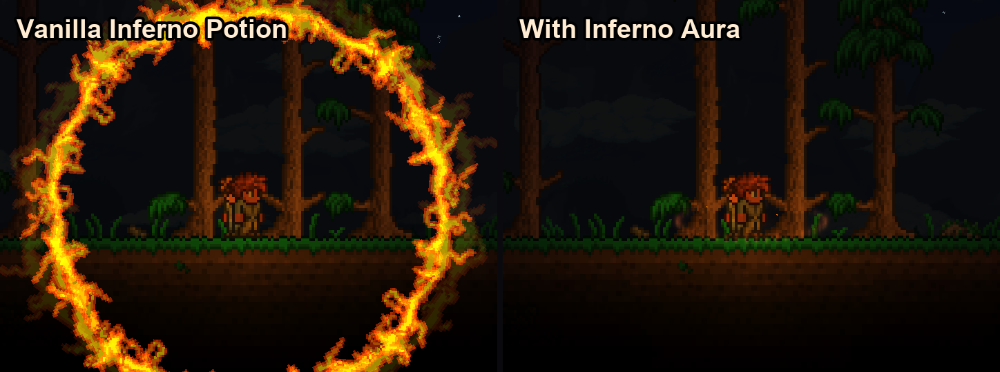
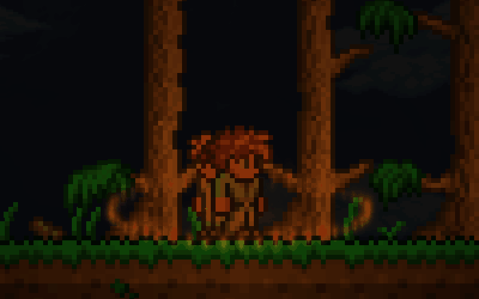

# Inferno Aura · tModLoader mod

Swaps the giant spinning ring of the Inferno Potion for a ring of flames on the ground
around the character, with a warm glow and a few embers. Visual only: damage, range and
the On Fire! debuff stay vanilla.





## How it works

- `On_Main.DrawInfernoRings` is replaced by an empty hook, so the vanilla ring is never
  drawn. The `inferno` flag that deals the damage lives in `Player.Update` and is never
  touched.
- `On_Main.DrawPlayers_AfterProjectiles` draws the aura in two additive passes: the far
  half of the ring and the heat glow before the players, the near half after them.
- The glow texture is generated at runtime, so the mod ships no image assets.
- `side = Both`: in multiplayer it is installed on the server, and tModLoader sends it to
  every player on join.

## Building

This folder is a regular mod source: it lives in
`.../Terraria/tModLoader/ModSources/InfernoAura/`. Build it from *Workshop > Develop Mods*
in game, or headless:

```bash
cd "<Steam>/steamapps/common/tModLoader"
./dotnet/dotnet tModLoader.dll -server -build "<ModSources>/InfernoAura"
```

## Publishing

*Workshop > Develop Mods > Inferno Aura > Publish* in game. The Workshop page text comes
from `description_workshop.txt`, the in-game text from `description.txt`, the change notes
from `changelog.txt`, the icons from `icon.png` (80x80) and `icon_workshop.png` (512x512).
Extra screenshots for the Workshop page are in `docs/workshop/` and are added on the
Steam page after publishing (*Add/edit images & videos*).

## License

MIT
